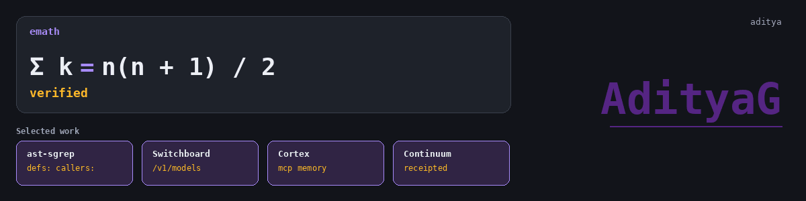

  
  
  
  

I write systems that turn intent into something you can run, inspect, and prove. [emath](https://github.com/AdityaVG13/emath) compiles mathematics into Rust. [TokenZero](https://github.com/AdityaVG13/tokenzero) keeps agent tool output out of the model until it is needed, then returns the original bytes.

## Selected work

### 1. [emath](https://github.com/AdityaVG13/emath)

Write the mathematics you mean. emath compiles it into inspectable Rust.

A `.emath` program can describe formulas, tensors, constraints, and goals. The compiler runs a deterministic pipeline (source, typed IR, resolution, generated Rust, Cargo artifact) and will not admit a result that fails `emath check` and `emath build --verify`.

`Rust` · `compiler` · `math`

### 2. [TokenZero](https://github.com/AdityaVG13/tokenzero)

Context compression for coding agents. Large reads, search results, and shell output become a bounded capsule; every omitted byte stays behind an exact local ref (`tz://`).

Recovery-aware: savings are counted after the original bytes can be restored, not after they are thrown away. 96–98% smaller on large source files, with byte-exact expansion on demand.

`Rust` · `RACC` · `MCP`

### 3. [ast-sgrep](https://github.com/AdityaVG13/ast-sgrep)

Hybrid lexical and AST graph search. ripgrep finds strings. ast-grep finds shapes. ast-sgrep finds intent.

Local-first, 15 languages, semantic search compiled into the binary with no API key. Ships as a standalone CLI and as a Pi package (`pi install npm:pi-ast-sgrep`).

`Rust` · `code search` · `Pi`

### 4. [Model Switchboard](https://github.com/AdityaVG13/Model-Switchboard)

Mac menu bar for local LLM runtimes. One click activates a profile and stops everything else. A profile is green only after a real `/v1/models` probe (or your custom HTTP check) succeeds.

llama.cpp, MLX, Ollama, vLLM, and the rest sit behind one OpenAI-compatible endpoint. SwiftUI, not Electron.

`Swift` · `macOS` · `local inference`

### 5. [Cortex](https://github.com/AdityaVG13/cortex)

Persistent shared memory for coding agents. Local-first Rust memory kernel over MCP and CLI, with plugins for Claude Code and Codex. One memory, every tool. Data stays on the machine.

`Rust` · `MCP` · `agent memory`

## Also shipping

| Project | What it is |
| :--- | :--- |
| [Continuum](https://github.com/AdityaVG13/Continuum) | Owner-gated control plane for the router you physically own. Every effect is receipted and reversible. |
| [pi-stack](https://github.com/AdityaVG13/pi-stack) | Pi packages: papercuts friction log, deferred context engine. |
| [gpr](https://github.com/AdityaVG13/gpr) | Goal-driven PRD ratchet: an agent loop that only marks work done when real artifacts pass real checks. |
| [TweetKB](https://github.com/AdityaVG13/TweetKB) | Private X bookmark knowledge base. Local SQLite, terminal-first, export to notes. |

